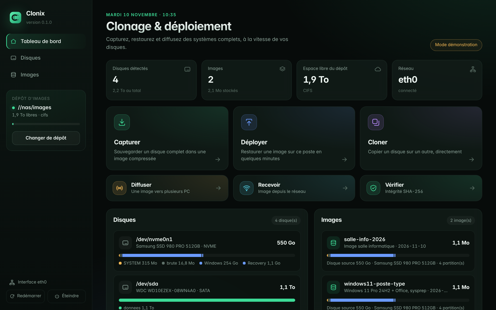
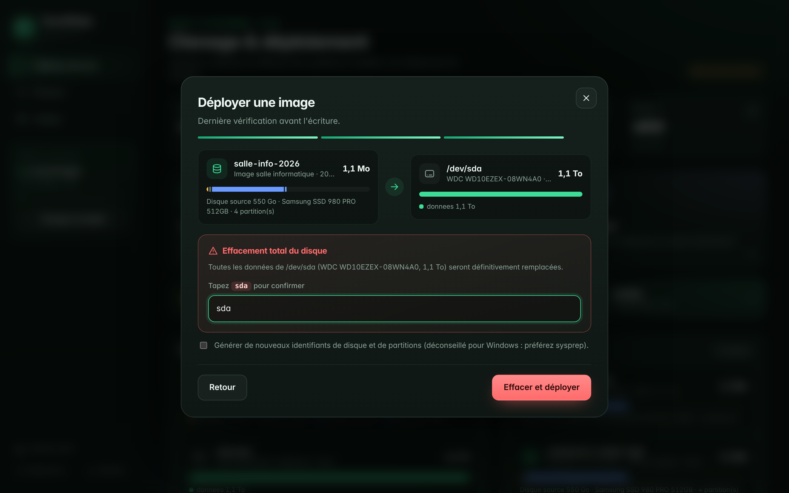
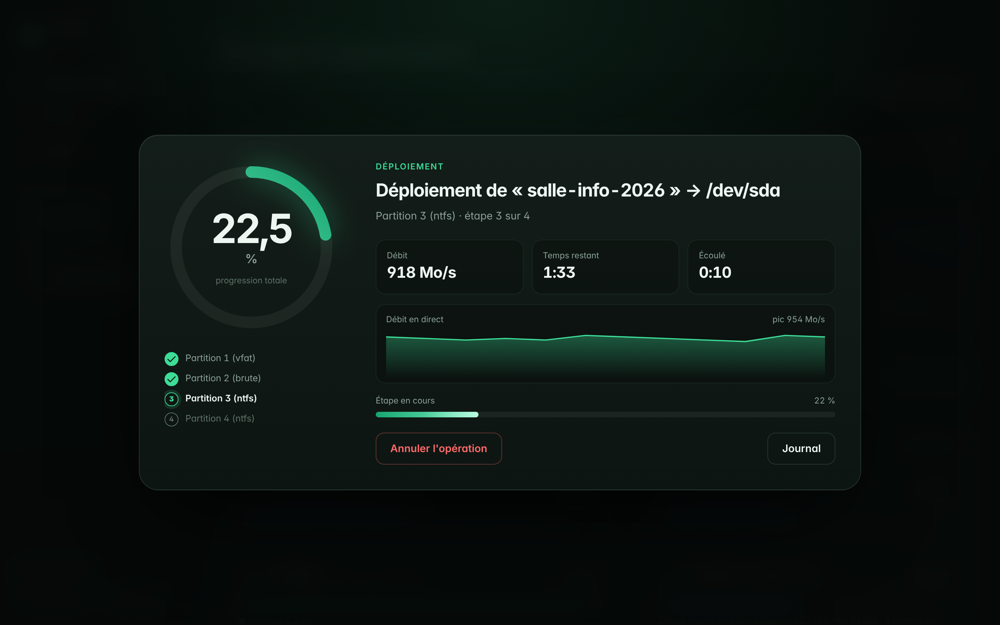

# Clonix

Logiciel de **clonage de PC** sur clé USB bootable : capture d'un disque en image,
déploiement d'une image sur un ou plusieurs postes, clonage direct disque à disque
et diffusion **multicast** vers tout un parc en une seule transmission.



| Confirmation avant effacement | Progression en direct |
|---|---|
|  |  |

## Fonctions

| Fonction | Ce qu'elle fait |
|---|---|
| **Capturer** | Sauvegarde un disque complet (table de partitions, zone d'amorçage, partitions) dans une image compressée, avec somme SHA-256 par fichier. |
| **Déployer** | Restaure une image sur un disque de même taille ou plus grand. |
| **Cloner** | Copie un disque directement sur un autre, sans passer par une image. |
| **Diffuser / Recevoir** | Envoie une image à N PC en même temps (udpcast) : une seule transmission réseau, quel que soit le nombre de postes. |
| **Vérifier** | Relit une image et contrôle toutes ses sommes SHA-256. |

Systèmes de fichiers copiés « intelligemment » (seulement les blocs utilisés, via
partclone) : NTFS, FAT/EFI, exFAT, ext2/3/4, Btrfs, XFS, F2FS, HFS+. Le reste
(BitLocker, LUKS, LVM, partitions sans système de fichiers) est copié bloc à bloc.
Tables MBR et GPT, démarrage BIOS et UEFI.

## Vitesse

- **Copie des seuls blocs utilisés** (partclone) : un disque de 500 Go rempli à
  60 Go se capture comme 60 Go.
- **Compression zstd multicœur**. Niveau « auto » : le plus rapide (`-1`) quand
  le dépôt est local, adaptatif (`--adapt`) sur un partage réseau, où c'est le
  réseau qui limite et où compresser plus permet d'envoyer moins.
- **Chemin de données parallélisé** : tubes de 1 Mio entre les processus, lecture et
  écriture côté Python dans deux fils avec une file tampon (le SHA-256 et
  l'écriture se recouvrent avec la lecture), blocs de 8 à 16 Mio. Mesuré à
  environ 1,2 Go/s en capture (SHA-256 compris) et 2,5 Go/s en restauration sur
  4 cœurs : ce n'est pas le goulot.
- **partclone** avec un tampon de 16 Mio et sans CRC par bloc (Clonix calcule
  déjà un SHA-256), uniquement si la version installée connaît ces options.
- **Clone brut** via deux `dd` reliés par un tube : la lecture et l'écriture se
  font en même temps au lieu de s'alterner.
- **Multicast** en mode full-duplex ; CPU passé en mode « performance » au
  démarrage de la clé.

## Interface

Au démarrage, la clé affiche l'interface graphique en plein écran (navigateur en
mode kiosque). Si l'affichage graphique échoue, un menu texte prend le relais.

Sécurité intégrée :

- la clé Clonix et le disque du dépôt d'images ne peuvent jamais être choisis
  comme cible ;
- un disque monté est refusé ;
- avant tout effacement, il faut **taper le nom du disque** (ex. `sda`) ;
- la taille du disque cible est vérifiée avant toute écriture.

Pour essayer l'interface sur n'importe quel ordinateur, sans toucher aux disques :

```bash
python3 -m clonix web --demo
```

(sous Windows : `py -m clonix web --demo`), puis ouvrir <http://127.0.0.1:8470/>.

### Accès depuis un autre PC

Ajoutez `clonix.remote` aux paramètres de démarrage de la clé (touche `e` ou
`Tab` dans le menu de démarrage). L'adresse et un **code d'accès à 6 chiffres**
s'affichent en haut de l'écran du poste ; ouvrez `http://ADRESSE:8470/` depuis un
autre PC, une tablette ou un téléphone, puis saisissez le code. Pratique pour
lancer une diffusion multicast depuis votre bureau.

Paramètre `clonix.text` : démarrer directement sur le menu texte.

## Créer la clé USB

Prérequis : Docker et un accès Internet (environ 4 Go d'espace libre). Sur Mac,
installez [Docker Desktop](https://www.docker.com/products/docker-desktop/) et
lancez-le avant la commande ; sur Mac à puce Apple (M1 à M4), la construction
passe par l'émulation x86 et prend plus longtemps (30 à 60 min).

```bash
./live/build.sh
```

L'image `live/out/clonix-AAAAMMJJ.iso` (hybride BIOS + UEFI) se copie sur une
clé avec Balena Etcher, Rufus (mode DD) ou :

```bash
sudo dd if=live/out/clonix-AAAAMMJJ.iso of=/dev/sdX bs=4M conv=fsync status=progress
```

Sur Mac, le plus simple est [balenaEtcher](https://etcher.balena.io/) ; ou en
ligne de commande (remplacez `diskN` par le numéro de la clé donné par
`diskutil list`) :

```bash
diskutil unmountDisk /dev/diskN
sudo dd if=live/out/clonix-AAAAMMJJ.iso of=/dev/rdiskN bs=4m
```

La clé est basée sur Debian 12 (bookworm) et contient partclone, zstd, udpcast,
les outils NTFS/FAT/ext/Btrfs/XFS, les clients SMB/NFS/SSH et les pilotes réseau
courants.

### Depuis Windows

1. Installez [Docker Desktop](https://www.docker.com/products/docker-desktop/)
   (il active WSL2 au premier lancement, un redémarrage peut être demandé), puis
   lancez-le.
2. Dans PowerShell, depuis le dossier du projet :

   ```powershell
   powershell -ExecutionPolicy Bypass -File live\build.ps1
   ```

3. Écrivez `live\out\clonix-AAAAMMJJ.iso` sur la clé avec
   [Rufus](https://rufus.ie/) : choisissez la clé, l'ISO, puis **« Écrire en mode
   Image DD »** quand Rufus le demande (le mode ISO ne fonctionnera pas), ou avec
   [balenaEtcher](https://etcher.balena.io/).

Le fichier `.gitattributes` garde les scripts en fins de ligne Linux même si le
dépôt est cloné avec Git pour Windows.

## Dépôt d'images

Les images sont lues et écrites dans `/srv/clonix/images`, où l'on monte au
choix : un disque externe, un partage Windows/NAS (SMB), un export NFS ou un
serveur SSH. Depuis l'interface : **Dépôt d'images → Configurer**.

Format d'une image (un dossier) :

```
poste-type/
├── clonix.json    manifeste : disque source, partitions, sommes SHA-256
├── table.sfdisk        table de partitions
├── boot.img            zone d'amorçage (avant la 1re partition)
├── p1.partclone.zst    une archive par partition
└── p3.dd.zst
```

## Ligne de commande

Tout ce que fait l'interface est disponible en ligne de commande (en root) :

```bash
clonix disks
clonix mount smb //192.168.1.10/images --user admin
clonix capture /dev/nvme0n1 poste-type --description "Windows 11 + Office"
clonix deploy poste-type /dev/sda
clonix clone /dev/sda /dev/sdb
clonix mcast-send poste-type --receivers 12
clonix mcast-recv /dev/sda
clonix verify poste-type
clonix password /dev/sda --list                # comptes du poste déployé
clonix password /dev/sda --user Administrator  # efface le mot de passe Windows
clonix password /dev/sda --user root --set     # définit un nouveau (Linux), demandé au clavier
clonix --dry-run deploy poste-type /dev/sda   # affiche les actions sans rien écrire
```

## Mot de passe administrateur

Après un déploiement, **Mot de passe** (ou `clonix password`) redonne la main sur
le compte administrateur local du poste, sans le démarrer. Clonix monte la
partition système du disque choisi et agit sur le compte local :

- **Windows** : via `chntpw` sur la ruche SAM. Le mot de passe est **effacé**
  (vide) ; vous en choisirez un nouveau au premier démarrage. Définir un mot de
  passe précis n'est pas fiable sous Windows 10/11, donc Clonix ne le propose pas.
- **Linux** : en modifiant `/etc/shadow` — effacer le mot de passe, ou en
  **définir** un nouveau (haché avec `openssl passwd -6`).

Garde-fous : la clé Clonix, le disque du dépôt et tout disque monté sont refusés,
comme pour un déploiement ; il faut taper le nom du disque pour confirmer. Ceci
ne contourne aucun chiffrement : une partition BitLocker ou LUKS verrouillée ne
se monte pas et l'opération s'arrête proprement. À n'utiliser que sur des postes
que vous administrez.

## Bonnes pratiques Windows

- Passez le poste modèle par **sysprep** (`/generalize /oobe`) avant la capture
  si l'image doit être déployée sur plusieurs PC.
- Désactivez **BitLocker** avant la capture : sinon la partition est copiée bloc à
  bloc (plus lent) et reste chiffrée.
- Arrêtez Windows complètement (pas de démarrage rapide/veille prolongée) : sinon
  NTFS est marqué « sale » et partclone refuse de le lire.
- L'option « nouveaux identifiants » modifie les GUID de disque/partitions ; elle
  peut empêcher Windows de démarrer en UEFI. Préférez sysprep.

## Limites actuelles

- Le disque cible doit être au moins aussi grand que l'espace partitionné du
  disque source (pas de réduction de partitions). Sur un disque plus grand,
  l'espace en plus reste libre.
- Pas de démarrage réseau (PXE) : chaque PC récepteur démarre sur une clé.

## Développement

Python 3.11+, bibliothèque standard uniquement. Tests (aucun disque réel touché) :

```bash
python3 -m unittest
```

Structure :

```
clonix/      code (CLI, opérations, multicast, serveur web, interface)
  static/         interface graphique (HTML/CSS/JS, sans dépendance externe)
tests/            tests unitaires et API avec outils disque simulés
live/             configuration de la clé USB (Debian live-build)
legacy/           ancien projet AgroManager, conservé tel quel
```
