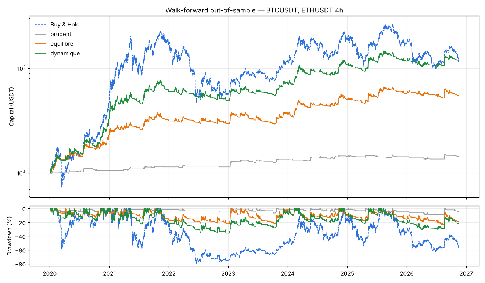

# CryptoBot — bot de trading BTC / ETH en monnaie fictive

Bot de trading algorithmique sur Bitcoin et Ethereum. Il **ne passe aucun ordre réel** :
aucune clé API n'est utilisée, le portefeuille est entièrement fictif.

Il couvre quatre usages :

1. **Backtest** : rejouer une stratégie sur l'historique réel Binance (2018 → aujourd'hui), avec frais et slippage.
2. **Optimisation walk-forward** : choisir les paramètres sans tricher et mesurer la performance sur des périodes jamais vues.
3. **Statistiques** : Sharpe, Sortino, Calmar, drawdown, profit factor, intervalles de confiance par bootstrap, *Probabilistic* et *Deflated Sharpe Ratio*.
4. **Paper trading** : le bot tourne en temps réel sur les vrais prix avec un capital fictif (10 000 $ par défaut).

## Installation

```bash
cd cryptobot
pip install -r requirements.txt
python -m pytest -q          # 37 tests
```

## Utilisation

```bash
python -m cryptobot profiles                       # les 3 profils de risque et leurs statistiques
python -m cryptobot paper --profile prudent        # paper trading en direct, profil « ne pas perdre »
python -m cryptobot walkforward --profile all      # vérifier soi-même les chiffres des profils
python -m cryptobot fetch                          # télécharge BTC/ETH en bougies 4h depuis 2018 (cache dans data/)
python -m cryptobot compare                        # toutes les stratégies, paramètres par défaut
python -m cryptobot backtest -s ema_cross -p fast=20 slow=100
python -m cryptobot walkforward -s all             # LE test qui compte : performance hors échantillon
python -m cryptobot paper -s ensemble              # paper trading en direct (Ctrl+C pour arrêter, relance = reprise)
python -m cryptobot paper -s ema_cross --optimize  # choisit d'abord les paramètres par walk-forward
```

Options communes : `--profile prudent|equilibre|dynamique`, `--symbols BTCUSDT ETHUSDT`, `--interval 4h|1h|1d…`, `--capital 10000`,
`--fee 0.001`, `--slippage 0.0005`, `--target-vol 0.6`, `--stop-atr 3`, `--band 0.25`, `--reentry cooldown|fresh`,
`--dd-halt 0.35`, `--synthetic` (données simulées, hors ligne), `--offline` (cache local uniquement).

Les graphiques et rapports sont écrits dans `reports/`, l'état du paper trading dans `state/`.

## Les algorithmes

| Stratégie | Idée |
|---|---|
| `ema_cross` | Suivi de tendance : investi quand l'EMA rapide est au-dessus de l'EMA lente |
| `donchian` | Cassure du plus haut de N bougies, sortie sur le plus bas de M bougies (type « Turtle ») |
| `macd` | Momentum MACD, uniquement quand le prix est au-dessus de sa moyenne longue |
| `tsmom` | Momentum multi-horizons (3 horizons), exposition graduée 0 / ⅓ / ⅔ / 1 |
| `mean_reversion` | Achat des excès de baisse (Bollinger + RSI) en tendance de fond haussière |
| `regime` | Détecte le régime (tendance ou range, via l'*efficiency ratio*) et change de logique |
| `ensemble` | Moyenne de `ema_cross`, `donchian`, `tsmom` et `macd` : diversification des modèles |
| `rotation` | Stratégie de portefeuille : ensemble + **filtre de marché BTC** (rien n'est acheté quand BTC est sous sa moyenne de 100 jours). Options de rotation BTC↔ETH testées, sans gain : désactivées |

**Gestion du risque** (`risk.py`), appliquée à toutes les stratégies :

- **Ciblage de volatilité** : la position est réduite quand le marché s'agite (60 % de volatilité annuelle visée).
- **Stop suiveur ATR** : sortie si le prix recule de 3 × ATR depuis son plus haut, puis attente de 6 bougies avant de pouvoir revenir.
- **Bande de rééquilibrage** : pas de micro-ajustements (chaque ordre coûte des frais).
- **Coupe-circuit** optionnel sur drawdown (`--dd-halt`).
- Spot uniquement : pas de levier, pas de vente à découvert.

**Réalisme du moteur** (`backtest.py`) : la décision est prise à la clôture d'une bougie et exécutée
à l'ouverture de la suivante, sans regarder le futur (un test le vérifie pour chaque stratégie).
Le moteur applique 0,1 % de frais et 0,05 % de slippage par ordre. Le stop est vérifié sur le plus
bas de la bougie, avec sortie à l'ouverture en cas de gap, et le bot ne peut jamais dépenser plus
que le cash disponible. Le portefeuille a une **trésorerie commune** à BTC et ETH : les ventes sont
exécutées avant les achats, et le total investi ne dépasse jamais 100 %.

## Les 3 profils de risque

Méthode : les profils ont été choisis par walk-forward sur 2018-2024 uniquement. La période
**2025-2026 a été mise de côté et testée une seule fois à la fin**. Sur cette période, le marché a
baissé : le Buy & Hold BTC/ETH perd 40 %. Tous les chiffres sont hors échantillon, en bougies 4h, sur
BTC + ETH, avec 0,1 % de frais et 0,05 % de slippage.

| | Buy & Hold | **prudent** | **equilibre** | **dynamique** |
|---|---:|---:|---:|---:|
| Rendement annualisé 2020-26 | +42,5 % | +5,5 % | +28,2 % | **+43,1 %** |
| Sharpe | 0,86 | 0,75 | 1,13 | **1,30** |
| Perte max. depuis un sommet | −79,6 % | **−8,8 %** | −23,6 % | −35,8 % |
| Pire année civile | −66,9 % | **−1,1 %** | −6,2 % | −18,5 % |
| Périodes de 12 mois perdantes | 40 % | **17 %** | 18 % | 19 % |
| Pire période de 12 mois | −76,6 % | **−7,9 %** | −23,2 % | −33,1 % |
| Gain médian sur 12 mois | +26,9 % | +5,7 % | +18,6 % | +23,2 % |
| Mois perdants | 42 % | 40 % | 51 % | 52 % |
| **Test final 2025-26** | **−40 %** | −0,4 % | **+9,1 %** | +7,8 % |



- **prudent** (`rotation` + filtre BTC, volatilité visée 30 %, stop, retour seulement sur nouveau signal) :
  il ne perd presque jamais beaucoup, mais il rapporte peu. Il est investi seulement 5 % du temps en moyenne.
- **equilibre** (`ensemble`, volatilité 60 %, stop 3 ATR) : le meilleur sur le test final.
- **dynamique** (`ensemble`, volatilité 100 %, sans stop) : rendement équivalent au Buy & Hold avec une
  perte maximale 2,2 fois plus faible, mais des années à −18 % restent possibles.

### Lecture honnête

- **Aucun profil ne garantit de ne pas perdre.** Même le plus prudent a perdu sur 17 % des périodes de
  12 mois et sur 40 % des mois (des pertes faibles : pire mois −2,7 %). Une stratégie qui ne
  perdrait jamais n'existe pas sur un marché public.
- **La protection en marché baissier est confirmée hors échantillon** : en 2022 (−67 %) comme en
  2025-26 (−40 %), tous les profils ont limité ou évité la baisse.
- **Le prix de la protection** : en marché très haussier (2020-2021), le bot gagne nettement moins que
  le Buy & Hold, car il n'est investi qu'une partie du temps.
- **Ce qui n'a pas marché** (testé en walk-forward puis abandonné) : la rotation BTC↔ETH vers l'actif le
  plus fort, la concentration du capital, le retour à la moyenne, un filtre BTC plus lent (200 jours).
- **Une amélioration non confirmée** : sur 2018-2024, la variante « volatilité 30 %, sans stop » paraissait
  la meilleure (Sharpe 1,73). Sur le test final, elle a fait moins bien que `equilibre` (+4,5 %
  contre +9,1 %). C'est un exemple concret de sur-optimisation : un résultat brillant sur le passé
  ne se répète pas forcément.
- **Les frais sont l'ennemi n°1** : avec 0,2 % de frais et 0,1 % de slippage, le rendement d'`equilibre`
  tombe d'environ 27 % à 15 % par an. Payer les frais en BNB (0,075 %) aide.
- Les intervalles de confiance à 90 % (bootstrap) restent larges : rendement annuel de +8 % à +51 %
  pour `equilibre`. Sept ans de données ne suffisent pas à garantir que l'avantage persistera.

**Aucun backtest ne garantit des gains futurs.** Faites tourner le paper trading plusieurs mois avant
d'envisager de l'argent réel. N'y mettez ensuite que ce que vous acceptez de perdre.

## Structure

```
cryptobot/
├── cryptobot/
│   ├── data.py          # téléchargement Binance + cache CSV + marché synthétique
│   ├── indicators.py    # EMA, RSI, MACD, Bollinger, ATR, ADX, Donchian, volatilité, efficiency ratio
│   ├── strategies/      # les 9 stratégies (dont buy & hold de référence)
│   ├── risk.py          # ciblage de volatilité, stops, rééquilibrage
│   ├── backtest.py      # moteur barre par barre, trésorerie commune multi-actifs
│   ├── metrics.py       # statistiques, PSR, DSR, bootstrap, fréquence des pertes
│   ├── optimize.py      # walk-forward
│   ├── profiles.py      # profils prudent / equilibre / dynamique
│   ├── paper.py         # paper trading temps réel
│   ├── report.py        # tableaux et graphiques
│   └── __main__.py      # ligne de commande
└── tests/test_bot.py
```
