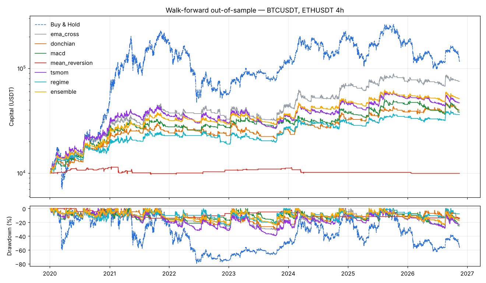

# CryptoBot — bot de trading BTC / ETH en monnaie fictive

Bot de trading algorithmique sur Bitcoin et Ethereum. Il **ne passe aucun ordre réel** :
aucune clé API n'est utilisée, le portefeuille est entièrement fictif.

Il couvre quatre usages :

1. **Backtest** : rejouer une stratégie sur l'historique réel Binance (2018 → aujourd'hui), avec frais et slippage.
2. **Optimisation walk-forward** : choisir les paramètres sans tricher et mesurer la performance sur des périodes jamais vues.
3. **Statistiques** : Sharpe, Sortino, Calmar, drawdown, profit factor, intervalles de confiance par bootstrap, *Probabilistic* et *Deflated Sharpe Ratio*.
4. **Paper trading** : le bot tourne en temps réel sur les vrais prix avec un capital fictif (10 000 $ par défaut).

## Installation

```bash
cd cryptobot
pip install -r requirements.txt
python -m pytest -q          # 31 tests
```

## Utilisation

```bash
python -m cryptobot fetch                          # télécharge BTC/ETH en bougies 4h depuis 2018 (cache dans data/)
python -m cryptobot compare                        # toutes les stratégies, paramètres par défaut
python -m cryptobot backtest -s ema_cross -p fast=20 slow=100
python -m cryptobot walkforward -s all             # LE test qui compte : performance hors échantillon
python -m cryptobot paper -s ensemble              # paper trading en direct (Ctrl+C pour arrêter, relance = reprise)
python -m cryptobot paper -s ema_cross --optimize  # choisit d'abord les paramètres par walk-forward
```

Options communes : `--symbols BTCUSDT ETHUSDT`, `--interval 4h|1h|1d…`, `--capital 10000`,
`--fee 0.001`, `--slippage 0.0005`, `--target-vol 0.6`, `--stop-atr 3`, `--band 0.25`,
`--dd-halt 0.35`, `--synthetic` (données simulées, hors ligne), `--offline` (cache local uniquement).

Les graphiques et rapports sont écrits dans `reports/`, l'état du paper trading dans `state/`.

## Les algorithmes

| Stratégie | Idée |
|---|---|
| `ema_cross` | Suivi de tendance : investi quand l'EMA rapide est au-dessus de l'EMA lente |
| `donchian` | Cassure du plus haut de N bougies, sortie sur le plus bas de M bougies (type « Turtle ») |
| `macd` | Momentum MACD, uniquement quand le prix est au-dessus de sa moyenne longue |
| `tsmom` | Momentum multi-horizons (3 horizons), exposition graduée 0 / ⅓ / ⅔ / 1 |
| `mean_reversion` | Achat des excès de baisse (Bollinger + RSI) en tendance de fond haussière |
| `regime` | Détecte le régime (tendance ou range, via l'*efficiency ratio*) et change de logique |
| `ensemble` | Moyenne de `ema_cross`, `donchian`, `tsmom` et `macd` : diversification des modèles |

**Gestion du risque** (`risk.py`), appliquée à toutes les stratégies :

- **Ciblage de volatilité** : la position est réduite quand le marché s'agite (60 % de volatilité annuelle visée).
- **Stop suiveur ATR** : sortie si le prix recule de 3 × ATR depuis son plus haut, puis attente de 6 bougies avant de pouvoir revenir.
- **Bande de rééquilibrage** : pas de micro-ajustements (chaque ordre coûte des frais).
- **Coupe-circuit** optionnel sur drawdown (`--dd-halt`).
- Spot uniquement : pas de levier, pas de vente à découvert.

**Réalisme du moteur** (`backtest.py`) : la décision est prise à la clôture d'une bougie et exécutée
à l'ouverture de la suivante, sans regarder le futur (un test le vérifie pour chaque stratégie).
Le moteur applique 0,1 % de frais et 0,05 % de slippage par ordre. Le stop est vérifié sur le plus
bas de la bougie, avec sortie à l'ouverture en cas de gap, et le bot ne peut jamais dépenser plus
que le cash disponible.

## Résultats (walk-forward, 4h, BTC + ETH 50/50, janv. 2020 → nov. 2026)

Les paramètres sont choisis sur 2 ans glissants puis appliqués aux 6 mois suivants. Les chiffres
ci-dessous portent **uniquement** sur ces périodes de test, jamais vues pendant l'optimisation.

| | Buy & Hold | ema_cross | ensemble | donchian | tsmom | mean_reversion |
|---|---:|---:|---:|---:|---:|---:|
| Rendement annualisé | **+42,5 %** | +34,1 % | +26,9 % | +22,3 % | +25,2 % | −0,1 % |
| Sharpe | 0,86 | **1,11** | 1,10 | 0,92 | 0,91 | 0,02 |
| Perte max. (drawdown) | −79,6 % | −31,3 % | **−23,7 %** | −29,9 % | −39,4 % | −15,6 % |
| Exposition moyenne | 100 % | 38 % | 31 % | 29 % | 40 % | 2 % |
| Trades par an | — | 79 | 170 | 58 | 166 | 10 |



Rendement année par année (out-of-sample) :

| | 2020 | 2021 | 2022 | 2023 | 2024 | 2025 | 2026 |
|---|---:|---:|---:|---:|---:|---:|---:|
| Buy & Hold | +375 % | +258 % | **−67 %** | +104 % | +65 % | −9 % | **−34 %** |
| ema_cross | +172 % | +38 % | −13 % | +30 % | +60 % | +8 % | +2 % |
| ensemble | +136 % | +35 % | −8 % | +21 % | +33 % | +12 % | −3 % |

### Lecture honnête

- **Le bot ne bat pas le Buy & Hold en rendement brut** sur cette période. Il le bat en **rendement
  ajusté du risque** : son Sharpe est plus élevé et sa perte maximale est divisée par 2,5 à 3. Il protège
  très bien dans les marchés baissiers (2022 : −8 % contre −67 %), mais il rate une partie des
  hausses explosives, car il n'est investi qu'un tiers du temps environ.
- **Les frais sont l'ennemi n°1.** Avec 0,2 % de frais et 0,1 % de slippage, le rendement annuel de
  `ensemble` tombe de +27 % à +15 %. Utiliser le BNB pour les frais, voire des ordres limites, compte donc beaucoup.
- **Le retour à la moyenne ne fonctionne pas** sur BTC/ETH en 4h : il ne rapporte rien. Le suivi de tendance fonctionne.
- Les intervalles de confiance à 90 % (bootstrap) restent larges : Sharpe de 0,4 à 1,7 pour `ensemble`.
  Six ans de données ne suffisent pas à garantir que l'avantage persistera.
- Les réglages de risque par défaut (stop 3 ATR, bande 25 %) ont été choisis sur tout l'historique
  parmi 32 variantes aux résultats proches. C'est un léger biais d'optimisation, à garder en tête.

**Aucun backtest ne garantit des gains futurs.** Faites tourner le paper trading plusieurs mois avant
d'envisager de l'argent réel. N'y mettez ensuite que ce que vous acceptez de perdre.

## Structure

```
cryptobot/
├── cryptobot/
│   ├── data.py          # téléchargement Binance + cache CSV + marché synthétique
│   ├── indicators.py    # EMA, RSI, MACD, Bollinger, ATR, ADX, Donchian, volatilité, efficiency ratio
│   ├── strategies/      # les 8 stratégies (dont buy & hold de référence)
│   ├── risk.py          # ciblage de volatilité, stops, rééquilibrage
│   ├── backtest.py      # moteur barre par barre
│   ├── metrics.py       # statistiques, PSR, DSR, bootstrap
│   ├── optimize.py      # walk-forward
│   ├── paper.py         # paper trading temps réel
│   ├── report.py        # tableaux et graphiques
│   └── __main__.py      # ligne de commande
└── tests/test_bot.py
```
